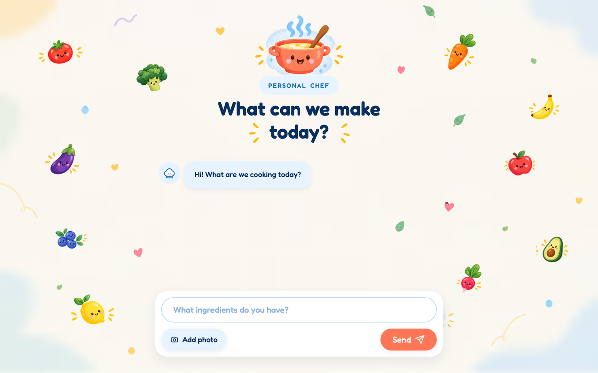
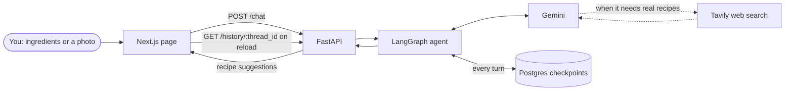

# Personal Chef

An AI cooking agent that turns the ingredients you have into meals you can actually make. Tell it what you have in your kitchen, or show it a photo, and it will suggest a few dishes and guide you through the one you pick.

- **Live demo**: (https://my-ai-personal-chef.vercel.app)



## How It Works



## Quick Start

You need Python 3.13 with [uv](https://docs.astral.sh/uv/) and Node.js.

```bash
cd backend
uv sync
cp .env.example .env              # fill in GOOGLE_API_KEY and TAVILY_API_KEY
uv run uvicorn api:app --reload   # http://localhost:8000
```

In a second terminal:

```bash
cd frontend
npm install
npm run dev                       # http://localhost:3000
```

Leave `DATABASE_URL` empty and conversations are saved to `backend/checkpoints.sqlite` instead of Postgres. The frontend calls `http://localhost:8000` unless `NEXT_PUBLIC_API_URL` says otherwise.

## API Keys

| Key | Powers |
|---|---|
| `GOOGLE_API_KEY` | Gemini: reading ingredients and writing the recipes ([get one](https://aistudio.google.com/apikey)) |
| `TAVILY_API_KEY` | Web search for real recipes ([get one](https://app.tavily.com)) |

## 📄 License

Copyright © 2026 Olga Aksenova.

The code in this repository is licensed under the **[Apache License, Version 2.0](https://www.apache.org/licenses/LICENSE-2.0)** – see [LICENSE](LICENSE) for the full text.
